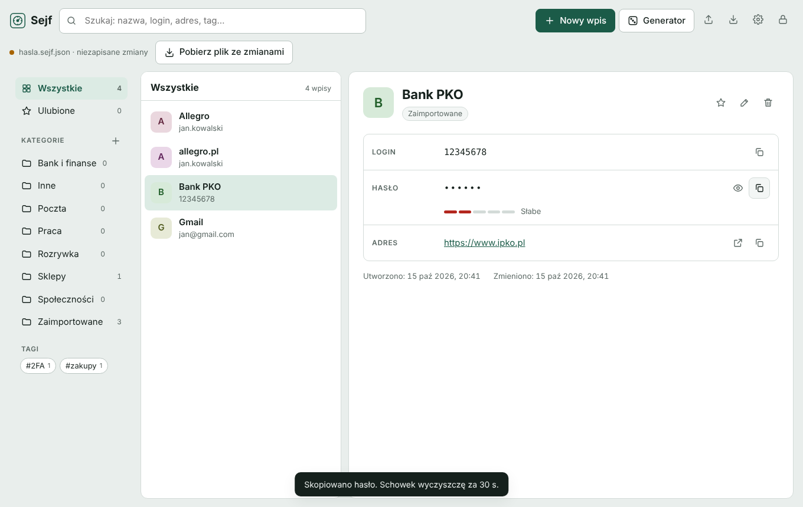
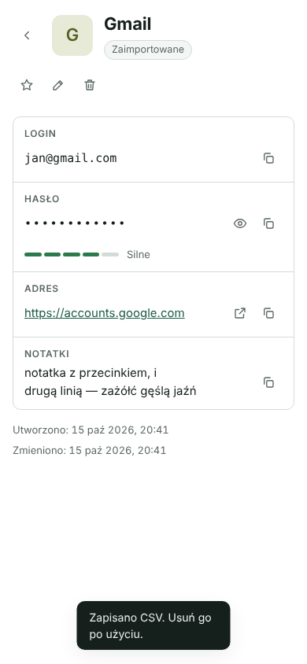

# Sejf

Prosty menedżer haseł w jednym pliku HTML. Hasła trzymasz w zaszyfrowanym pliku, który leży u Ciebie, na przykład w folderze Dysku Google albo OneDrive. Program nie łączy się z żadnym serwerem i nie wysyła nigdzie Twoich danych.



## Co potrafi

- **Szyfrowanie** AES-256-GCM z kluczem z hasła głównego (PBKDF2-SHA256, 600 000 iteracji).
- **Kategorie, tagi i wyszukiwarka.** Szukanie działa także bez polskich znaków: „zazolc” znajdzie „zażółć”.
- **Generator haseł** z wyborem długości (8–64) i rodzajów znaków oraz opcją bez podobnych znaków (l, 1, O, 0).
- **Kopiowanie do schowka z auto-czyszczeniem** po 15, 30 lub 60 sekundach.
- **Import z CSV**: Chrome, Edge, Opera, Firefox, Bitwarden, KeePass/KeePassXC, 1Password. Powtórzone wpisy są pomijane.
- **Eksport** jako zaszyfrowana kopia zapasowa albo CSV bez szyfrowania (po świadomym potwierdzeniu).
- **Ocena siły hasła** i ostrzeżenie, gdy to samo hasło jest użyte w kilku kontach.
- **Historia poprzednich haseł** każdego wpisu (ostatnie 10).
- **Automatyczna blokada** po bezczynności (1–60 minut).
- **Autozapis i synchronizacja** (Windows): zmiany trafiają od razu do pliku. Jeśli plik zmieni się na innym urządzeniu, Sejf wczyta nową wersję. Gdy obie strony mają zmiany, zapyta, którą zachować.
- Jasny i ciemny motyw, widok dopasowany do telefonu.

## Instalacja na Windows

1. Pobierz z folderu [`dist/`](dist/) dwa pliki: `Sejf.html` i `Uruchom Sejf.cmd`. Połóż je w jednym folderze, np. `C:\Programy\Sejf`.
2. Uruchom `Uruchom Sejf.cmd`. Sejf otworzy się w osobnym oknie Microsoft Edge, jak zwykły program. Skrót do tego pliku możesz przypiąć do paska zadań lub menu Start.
3. Kliknij **Utwórz nowy sejf**, ustaw hasło główne i zapisz plik sejfu (np. `hasla.sejf.json`) w folderze **Dysku Google** lub **OneDrive** na komputerze.
4. Przy kolejnych uruchomieniach Sejf pamięta ostatni plik, więc wystarczy wpisać hasło główne.

Automatyczny zapis do pliku działa w Edge i Chrome. W innych przeglądarkach (np. Firefox) zmiany zapisujesz przyciskiem **Pobierz plik ze zmianami**.

> **Hasła głównego nie da się odzyskać.** Jeśli je zapomnisz, nikt, łącznie z autorem programu, nie odszyfruje pliku. Zrób też zaszyfrowaną kopię zapasową (ikona pobierania → „Zapisz kopię”) i trzymaj ją poza chmurą.

## Telefon

Plik sejfu z Dysku Google lub OneDrive otworzysz na telefonie w tej samej aplikacji Sejf uruchomionej w przeglądarce. Przeglądarki na telefonach nie otwierają jednak lokalnych plików HTML, więc aplikacja musi być dostępna pod adresem internetowym. Najprościej opublikować plik `dist/Sejf.html` przez **GitHub Pages** albo na dowolnym hostingu stron statycznych.

Hasła i tak nie opuszczają telefonu: strona tylko dostarcza program, a szyfrowanie i odszyfrowanie odbywa się w przeglądarce. Na telefonie:

- **Otwórz plik sejfu** → wybierz plik z Dysku Google lub OneDrive.
- Przeglądanie, wyszukiwanie i kopiowanie haseł działa normalnie.
- Po zmianach naciśnij **Pobierz plik ze zmianami** i podmień plik na Dysku. Przeglądarki na telefonach nie pozwalają nadpisać pliku w chmurze bezpośrednio, dlatego zmiany najwygodniej wprowadzać na komputerze.



## Bezpieczeństwo

| Element | Rozwiązanie |
|---|---|
| Szyfrowanie danych | AES-256-GCM (Web Crypto API), losowy 12-bajtowy IV przy każdym zapisie |
| Klucz | PBKDF2-HMAC-SHA256, 600 000 iteracji, losowa 16-bajtowa sól na sejf |
| Integralność | Tag uwierzytelniający GCM wykrywa każdą zmianę pliku i złe hasło |
| Sieć | Wersja z `dist/` ma politykę CSP `connect-src 'none'`: strona nie może wysłać żadnego zapytania. Jedyne zewnętrzne zasoby to czcionki Google Fonts |
| Pamięć | Po zablokowaniu klucz i odszyfrowane dane są usuwane z pamięci strony. Klucza nie da się wyeksportować (`extractable: false`) |
| Losowość | `crypto.getRandomValues` z próbkowaniem odrzucającym, bez przesunięcia rozkładu |

Ograniczenia, o których warto wiedzieć:

- Auto-czyszczenie schowka działa, gdy okno Sejfu jest aktywne. Jeśli w tym czasie przejdziesz do innego programu, schowek zostanie wyczyszczony po powrocie do Sejfu.
- Sejf nie wypełnia formularzy logowania w przeglądarce. Hasła kopiujesz przyciskiem.
- To projekt hobbystyczny bez zewnętrznego audytu bezpieczeństwa.

### Format pliku sejfu

Plik to JSON, który można odszyfrować standardowymi narzędziami:

```json
{
 "format": "sejf-vault",
 "version": 1,
 "kdf": { "name": "PBKDF2-SHA256", "iterations": 600000, "salt": "<base64>" },
 "cipher": { "name": "AES-256-GCM", "iv": "<base64>" },
 "data": "<base64: szyfrogram + 16-bajtowy tag>"
}
```

Dane dodatkowe (AAD) to tekst `sejf-vault/1`. Hasło główne jest normalizowane do postaci Unicode NFC. Po odszyfrowaniu dostajesz JSON z listą `entries` (tytuł, login, hasło, adres, notatki, kategoria, tagi, ulubione, historia haseł).

## Rozwój

```
src/app.html            kod aplikacji (HTML, CSS i JavaScript w jednym pliku)
src/Uruchom Sejf.cmd    plik uruchamiający dla Windows
scripts/build.sh        składa dist/Sejf.html z polityką CSP
dist/                   gotowe pliki do pobrania
tests/                  testy w przeglądarce (Playwright)
```

```sh
npm install
npx playwright install chromium
npm test        # buduje dist/ i uruchamia testy
```

Testy sprawdzają między innymi: tworzenie i odblokowanie sejfu, odrzucenie złego hasła, niezależne odszyfrowanie pliku w Node.js, import CSV (cudzysłowy, przecinki i nowe linie w polach, polskie znaki, duplikaty), generator haseł, schowek, historię haseł, autozapis, wczytanie zmian z innego urządzenia i rozwiązywanie konfliktu wersji oraz brak poziomego przewijania na telefonie.

Po zmianie `src/app.html` uruchom `npm run build` i dołącz zaktualizowany `dist/` do commita. Workflow na GitHubie sprawdza, czy `dist/` jest aktualny.

## Licencja

MIT
