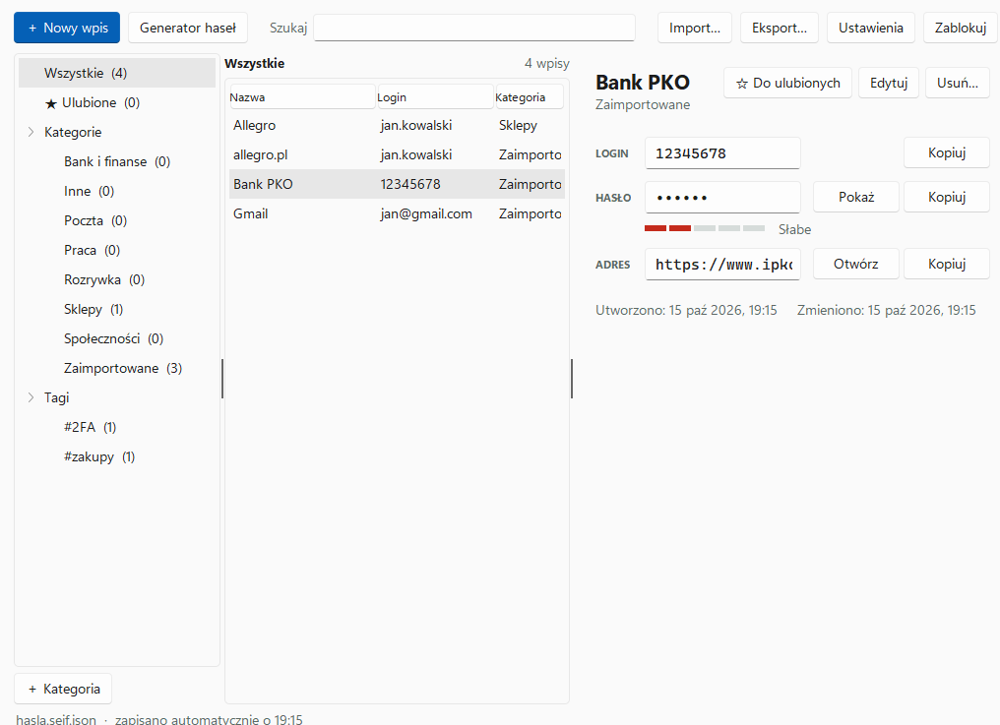
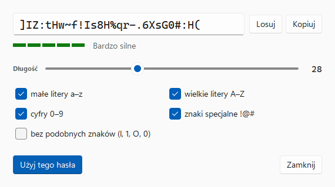
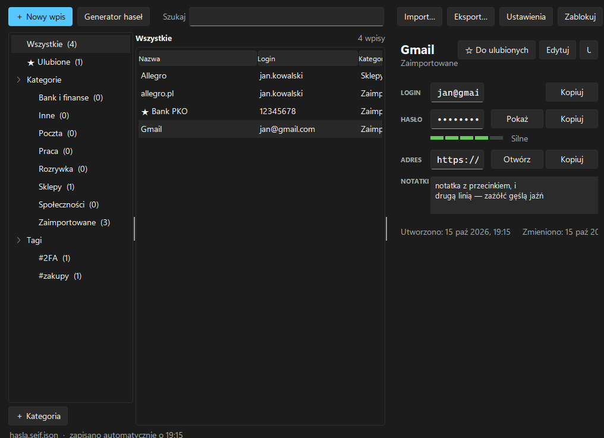

# Sejf

Prosty menedżer haseł dla Windows. Hasła trzymasz w zaszyfrowanym pliku, który leży u Ciebie, na przykład w folderze Dysku Google albo OneDrive. Program nie łączy się z żadnym serwerem i nie wysyła nigdzie Twoich danych.



## Pobieranie

Najnowszy **Sejf.exe** znajdziesz w zakładce [Releases](https://github.com/marpi1980/sejf/releases/latest). Program nie wymaga instalacji: pobierz plik, umieść go np. w `C:\Programy\Sejf` i uruchom.

Przy pierwszym uruchomieniu Windows może pokazać okno „System Windows ochronił ten komputer”, bo program nie ma płatnego podpisu cyfrowego. Kliknij **Więcej informacji → Uruchom mimo to**. Każdy plik `.exe` w wydaniach jest budowany automatycznie z kodu w tym repozytorium przez GitHub Actions.

## Co potrafi

- **Szyfrowanie** AES-256-GCM z kluczem z hasła głównego (PBKDF2-SHA256, 600 000 iteracji).
- **Kategorie, tagi i wyszukiwarka.** Szukanie działa także bez polskich znaków: „zazolc” znajdzie „zażółć”.
- **Generator haseł** z wyborem długości (8–64) i rodzajów znaków oraz opcją bez podobnych znaków (l, 1, O, 0).
- **Kopiowanie do schowka z auto-czyszczeniem** po 15, 30 lub 60 sekundach. Skopiowane hasła nie trafiają do historii schowka Windows (Win+V) ani do schowka w chmurze.
- **Import z CSV**: Chrome, Edge, Opera, Firefox, Bitwarden, KeePass/KeePassXC, 1Password. Rozpoznaje też pliki z polskiego Excela (Windows-1250, średniki). Powtórzone wpisy są pomijane.
- **Eksport** jako zaszyfrowana kopia zapasowa albo CSV bez szyfrowania (po świadomym potwierdzeniu).
- **Ocena siły hasła** i ostrzeżenie, gdy to samo hasło jest użyte w kilku kontach.
- **Historia poprzednich haseł** każdego wpisu (ostatnie 10).
- **Automatyczna blokada** po bezczynności (1–60 minut).
- **Autozapis i synchronizacja**: zmiany trafiają od razu do pliku. Jeśli plik zmieni się na innym urządzeniu, Sejf wczyta nową wersję. Gdy obie strony mają zmiany, zapyta, którą zachować.
- Jasny i ciemny motyw w stylu Windows 11, zgodny z ustawieniem systemu.

<p>


</p>

## Pierwsze uruchomienie

1. Kliknij **Utwórz nowy sejf…** i ustaw hasło główne.
2. Zapisz plik sejfu (np. `hasla.sejf.json`) w folderze **Dysku Google** lub **OneDrive**. Sejf sam zaproponuje taki folder, jeśli go znajdzie.
3. Przy kolejnych uruchomieniach Sejf pamięta ostatni plik, więc wystarczy wpisać hasło główne.

Skróty klawiszowe: **Ctrl+N** nowy wpis, **Ctrl+F** wyszukiwanie, **Ctrl+L** blokada, **Ctrl+S** zapis edytowanego wpisu. Na liście: **dwuklik** lub **Ctrl+C** kopiuje hasło, **Ctrl+B** kopiuje login, **Delete** usuwa wpis, prawy przycisk myszy otwiera menu.

> **Hasła głównego nie da się odzyskać.** Jeśli je zapomnisz, nikt, łącznie z autorem programu, nie odszyfruje pliku. Zrób też zaszyfrowaną kopię zapasową (**Eksport… → Zapisz kopię…**) i trzymaj ją poza chmurą.

## Telefon

Ten sam plik sejfu otworzy wersja przeglądarkowa z folderu [`web/`](web/) (w wydaniach jako `Sejf-telefon.html`). Szyfrowanie odbywa się w przeglądarce, hasła nie opuszczają telefonu. Przeglądarki na telefonach nie otwierają jednak lokalnych plików HTML, więc tę wersję trzeba udostępnić pod adresem internetowym, np. przez GitHub Pages.

## Bezpieczeństwo

| Element | Rozwiązanie |
|---|---|
| Szyfrowanie danych | AES-256-GCM, losowy 12-bajtowy IV przy każdym zapisie |
| Klucz | PBKDF2-HMAC-SHA256, 600 000 iteracji, losowa 16-bajtowa sól na sejf |
| Integralność | Tag uwierzytelniający GCM wykrywa każdą zmianę pliku i złe hasło |
| Zapis | Najpierw do pliku tymczasowego, potem podmiana, więc przerwany zapis nie uszkodzi sejfu |
| Schowek | Hasła oznaczone jako wykluczone z historii schowka i synchronizacji w chmurze; czyszczenie tylko wtedy, gdy w schowku nadal jest to samo hasło |
| Sieć | Program nie wykonuje żadnych połączeń sieciowych |
| Losowość | Moduł `secrets` (systemowy generator kryptograficzny) |

Ograniczenia, o których warto wiedzieć:

- Python nie pozwala na pewne wymazanie danych z pamięci. Po zablokowaniu program usuwa odwołania do klucza i haseł, ale ich kopie mogą przez chwilę pozostać w pamięci procesu.
- Sejf nie wypełnia formularzy logowania w przeglądarce. Hasła kopiujesz przyciskiem lub skrótem.
- To projekt hobbystyczny bez zewnętrznego audytu bezpieczeństwa.

### Format pliku sejfu

Plik to JSON, który można odszyfrować standardowymi narzędziami:

```json
{
 "format": "sejf-vault",
 "version": 1,
 "kdf": { "name": "PBKDF2-SHA256", "iterations": 600000, "salt": "<base64>" },
 "cipher": { "name": "AES-256-GCM", "iv": "<base64>" },
 "data": "<base64: szyfrogram + 16-bajtowy tag>"
}
```

Dane dodatkowe (AAD) to tekst `sejf-vault/1`. Hasło główne jest normalizowane do postaci Unicode NFC. Po odszyfrowaniu dostajesz JSON z listą `entries` (tytuł, login, hasło, adres, notatki, kategoria, tagi, ulubione, historia haseł).

## Rozwój

```
sejf/            kod programu
  crypto.py      szyfrowanie i format pliku
  session.py     otwarty sejf: zapis, synchronizacja, zmiana hasła głównego
  vault.py       wpisy, kategorie, tagi, wyszukiwanie
  csvio.py       import i eksport CSV
  generator.py   generator i ocena siły haseł
  clipboard.py   schowek wykluczony z historii Windows
  gui.py         interfejs okienkowy (tkinter + motyw Sun Valley)
tests/           testy rdzenia i interfejsu
web/             wersja przeglądarkowa (telefon)
Sejf.pyw         punkt wejścia
```

Uruchomienie z kodu (Python 3.12):

```sh
pip install -r requirements.txt
python Sejf.pyw
```

Testy i budowa pliku `.exe`:

```sh
pip install -r requirements-dev.txt
python -m unittest tests.test_core tests.test_gui
pyinstaller --onefile --windowed --name Sejf --icon assets/sejf.ico --collect-data sv_ttk --hidden-import darkdetect Sejf.pyw
```

Przy każdej zmianie GitHub Actions uruchamia testy na Linuksie i Windows (w tym test okien ze zrzutami ekranu), buduje `Sejf.exe` i sprawdza, czy zbudowany program działa. Nowe wydanie powstaje po wypchnięciu tagu, np. `git tag v2.0.1 && git push --tags`.

## Licencja

MIT
