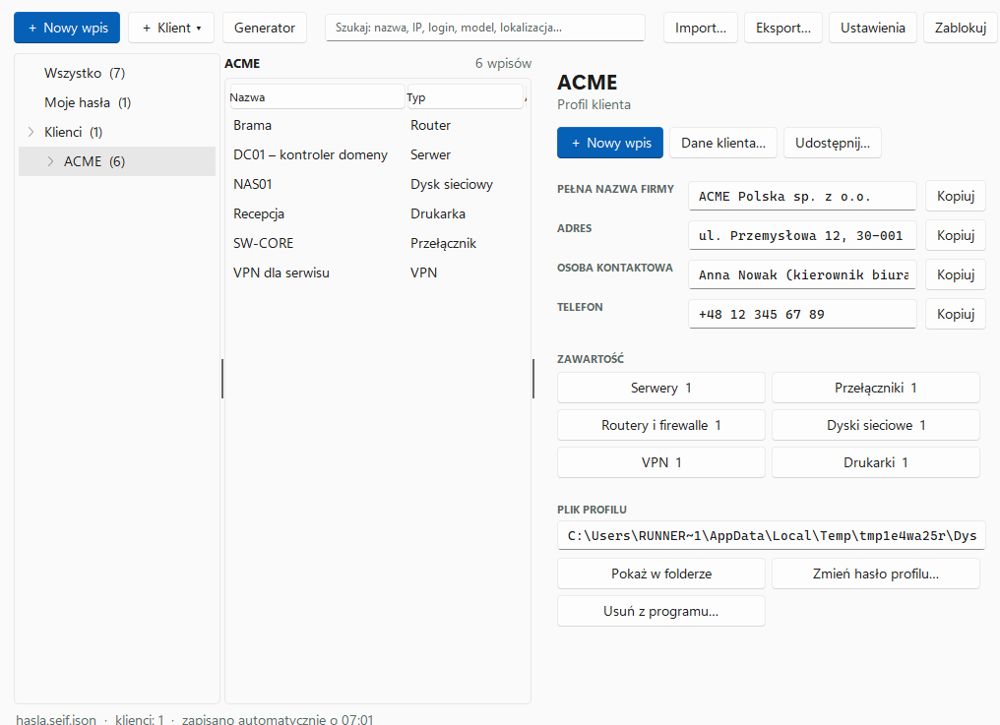
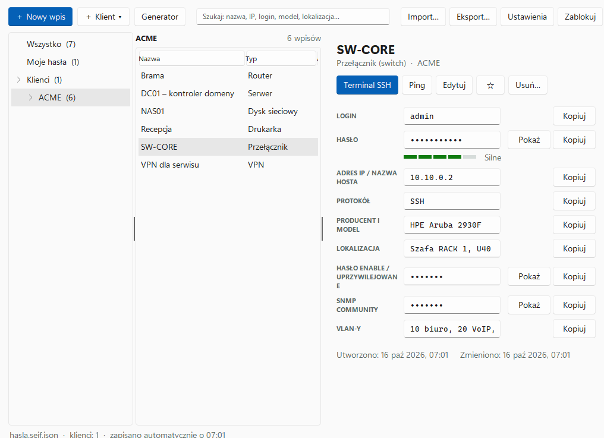
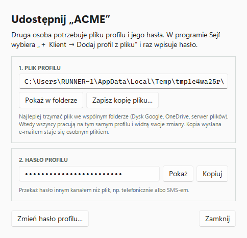
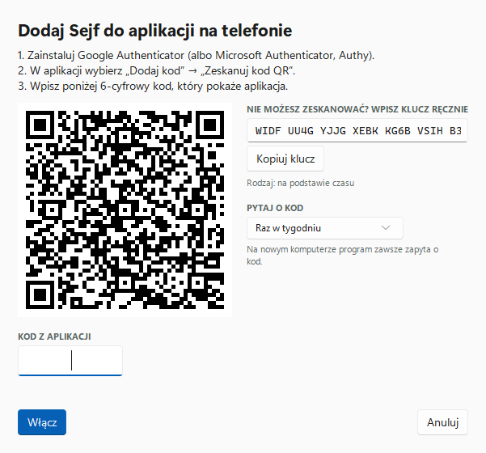

# Sejf

Menedżer haseł dla Windows dla osób, które obsługują sieci i komputery w firmach. Obok własnych haseł trzymasz w nim **profile klientów**: dane do serwerów, switchy, routerów, dysków sieciowych, VPN, drukarek i innych urządzeń w sieci. Każdy profil to osobny zaszyfrowany plik, który możesz przekazać współpracownikowi albo trzymać we wspólnym folderze zespołu.

Program nie łączy się z żadnym serwerem i nie wysyła nigdzie Twoich danych.



## Pobieranie

Najnowszy **Sejf.exe** znajdziesz w zakładce [Releases](https://github.com/marpi1980/sejf/releases/latest). Program nie wymaga instalacji: pobierz plik, umieść go np. w `C:\Programy\Sejf` i uruchom.

Przy pierwszym uruchomieniu Windows może pokazać okno „System Windows ochronił ten komputer”, bo program nie ma płatnego podpisu cyfrowego. Kliknij **Więcej informacji → Uruchom mimo to**. Każdy plik `.exe` w wydaniach jest budowany automatycznie z kodu w tym repozytorium przez GitHub Actions.

## Jak to działa

```
 Twój sejf (hasla.sejf.json)               Wspólny folder zespołu
 hasło główne (Argon2id)                   ┌───────────────────────────┐
 + Google Authenticator                    │ ACME.sejfklient           │  osoby: Ty, Anna
 ┌──────────────────────────────┐          │ Biuro Rachunkowe.…        │  osoby: Ty
 │ Moje hasła                   │          │ Przychodnia.…             │  osoby: Anna, Piotr
 │ Twój klucz osobisty ─────────┼─────────►└───────────────────────────┘
 │ lista Twoich profili         │   każdy profil ma klucz opakowany osobno dla każdej osoby
 └──────────────────────────────┘
```

- **Osobisty sejf** chroni hasło główne. Są w nim Twoje własne hasła, lista profili klientów i Twój klucz osobisty.
- **Profil klienta** to osobny plik `.sejfklient`. Jego dane szyfruje losowy klucz profilu, a ten klucz jest zapisany osobno dla każdej osoby z dostępem, zaszyfrowany jej kluczem. Nikt nie musi znać żadnego wspólnego hasła.
- **Dodanie osoby**: współpracownik kopiuje swój kod (**Ustawienia → Mój kod**) i Ci go wysyła. Ty wklejasz kod w oknie **Udostępnij**. On wybiera **＋ Klient → Dodaj profil z pliku** i profil otwiera się bez hasła.
- **Odebranie dostępu**: **Udostępnij → Odbierz dostęp**. Profil dostaje nowy klucz, którego ta osoba już nie otrzyma. Kto wcześniej skopiował plik, nadal otworzy tę starą kopię, dlatego przy odejściu pracownika zmień też hasła do samych urządzeń.
- **Dostęp hasłem profilu** (opcjonalny, domyślnie wyłączony): każdy, kto zna hasło, otworzy profil i zostanie dopisany do osób. Wygodne przy pierwszym przekazaniu, ale bezpieczniej dodawać osoby kodami.
- **Praca zespołowa**: gdy kilka osób pracuje na tym samym pliku we wspólnym folderze, program łączy zmiany. Wpis dodany przez Annę i wpis dodany przez Ciebie zostaną oba, a przy zmianie tego samego wpisu wygrywa nowsza zmiana.
- **Dziennik zmian** profilu pokazuje, kto i kiedy dodał, zmienił lub usunął wpis, skopiował albo wyświetlił hasło, połączył się z urządzeniem, dodał lub usunął osobę.

## Co potrafi

**Typy wpisów** z polami dopasowanymi do rodzaju sprzętu i usług:

| Typ | Pola dodatkowe |
|---|---|
| Komputer / stanowisko | użytkownik (imię i nazwisko), dział, nazwa komputera, IP, domena, logowanie do Windows, e-mail i hasło do poczty, dysk sieciowy z loginem i hasłem, program do zdalnej pomocy (RustDesk, AnyDesk, TeamViewer, RDP…) z ID i hasłem, PIN Windows Hello, klucz BitLocker, Office, antywirus, model, numer seryjny, MAC, pokój, gwarancja |
| Serwer | adres IP, protokół (RDP, SSH…), port, system, domena, rola, konsola iDRAC / iLO / IPMI z użytkownikiem i hasłem, model, numer seryjny, lokalizacja |
| Przełącznik (switch) | adres, protokół, port, model, numer seryjny, MAC, lokalizacja, firmware, hasło enable, SNMP community, VLAN-y |
| Router / firewall | jak wyżej oraz adres publiczny WAN i dostawca internetu |
| Dysk sieciowy (NAS) | jak wyżej oraz udział sieciowy `\\nas\udział` |
| VPN | serwer, rodzaj (OpenVPN, WireGuard, IPsec, FortiClient…), port, klucz PSK, sieć za VPN |
| Drukarka, punkt dostępowy, kamera / NVR, UPS, inne urządzenie | adres, protokół, model, numer seryjny, MAC, lokalizacja i pola typowe dla urządzenia |
| Sieć Wi-Fi | SSID, zabezpieczenia, hasło, VLAN, pasmo |
| Baza danych | adres, port, silnik, instancja, nazwa bazy |
| Konto (AD, Microsoft 365, Google), skrzynka e-mail, program | domena, tenant, serwery IMAP/SMTP, wersja |
| Licencja / klucz produktu | produkt, klucz, liczba stanowisk, data ważności (z ostrzeżeniem przed wygaśnięciem) |
| Strona / konto internetowe, notatka | |

Pola tajne (hasło enable, SNMP, PSK, klucze licencyjne, BitLocker) są ukryte i kopiowane tak samo bezpiecznie jak hasła.

**Pola dopasujesz do siebie:**

- **Zbędne pole usuniesz** z formularza danego typu krzyżykiem ✕ przy jego nazwie. Wróci przez **＋ Dodaj pole**, tam jest też „Przywróć wszystkie pola tego typu”. Ustawienie jest Twoje (zapisuje się w osobistym sejfie) i nie zmienia formularzy współpracowników.
- **Własne pole**, np. „Numer inwentarzowy”, dodasz przez **＋ Dodaj pole → Własne pole…**. Może być tajne i może się dodawać do każdego nowego wpisu tego typu.
- **Kilka kont na jednym urządzeniu**: przycisk **＋ Dodaj kolejne konto** dodaje do serwera czy komputera kolejne konto z opisem, loginem i hasłem, np. lokalnego administratora, konto serwisowe albo konto kopii zapasowych.

**Połączenie jednym kliknięciem**: przycisk **Pulpit zdalny (RDP)**, **Terminal SSH**, **Otwórz w przeglądarce**, **Konsola zarządzania** (iDRAC / iLO), **Połącz przez RustDesk / AnyDesk / TeamViewer**, **Otwórz dysk** albo **Otwórz udział**, zależnie od wpisu. Właściwe hasło trafia wtedy do schowka, wystarczy je wkleić. Przycisk **Ping** otwiera `ping -t` do urządzenia.

<p>


</p>

Pozostałe funkcje:

- **Wyszukiwarka** przeszukuje nazwy, adresy IP, loginy, modele, lokalizacje i notatki we wszystkich profilach naraz, także bez polskich znaków („serwerownia”, „10.10.0”, „aruba”).
- **Karta klienta**: pełna nazwa firmy, NIP, adres, osoba kontaktowa, telefon, umowa serwisowa i notatki.
- **Import list urządzeń** z arkusza CSV z kolumnami takimi jak Typ, Nazwa, IP, Login, Hasło, Model, Lokalizacja (także ze średnikami i z polskiego Excela) oraz import haseł z Chrome, Edge, Firefox, Bitwarden, KeePass i 1Password.
- **Blokada razem z Windows**: sejf blokuje się, gdy zablokujesz komputer (Win+L) albo komputer przejdzie w uśpienie.
- **Weryfikacja dwuetapowa** kodem z Google Authenticator (lub Microsoft Authenticator, Authy). Program prosi o kod na każdym nowym komputerze i potem okresowo: przy każdym odblokowaniu, raz dziennie, raz w tygodniu, co 2 tygodnie albo co 30 dni. Do tego 8 jednorazowych kodów zapasowych.
- **Generator haseł** oraz ocena siły hasła i ostrzeżenie o tym samym haśle w kilku miejscach.
- **Schowek z auto-czyszczeniem**. Skopiowane hasła nie trafiają do historii schowka Windows (Win+V) ani do schowka w chmurze.
- **Historia poprzednich haseł** każdego wpisu, **automatyczna blokada**, jasny i ciemny motyw.



## Pierwsze uruchomienie

1. Kliknij **Utwórz nowy sejf…**, ustaw hasło główne i zapisz plik sejfu.
2. W **Ustawienia → Mój kod…** wpisz swoje imię i nazwisko. Tak zobaczą Cię współpracownicy na listach osób i w dziennikach.
3. Dodaj klienta: **＋ Klient → Nowy profil klienta…**. Jeśli profil ma być wspólny, wybierz folder zespołu. Współpracowników dodasz w oknie **Udostępnij** ich kodami.
4. W profilu dodawaj wpisy przyciskiem **＋ Nowy wpis**, wybierając typ (serwer, komputer, switch, VPN…).
5. W **Ustawieniach** włącz weryfikację dwuetapową i zapisz kody zapasowe.

Skróty klawiszowe: **Ctrl+N** nowy wpis, **Ctrl+F** wyszukiwanie, **Ctrl+L** blokada, **Ctrl+S** zapis edytowanego wpisu. Na liście: **dwuklik** lub **Ctrl+C** kopiuje hasło, **Ctrl+B** kopiuje login, **Delete** usuwa wpis, prawy przycisk myszy otwiera menu (także na profilu w drzewie po lewej).

> **Hasła głównego nie da się odzyskać.** Jeśli je zapomnisz, stracisz dostęp do swoich haseł i do zapamiętanych haseł profili (same profile otworzysz ponownie, jeśli znasz ich hasła). Zrób zaszyfrowaną kopię zapasową sejfu (**Eksport… → Zapisz kopię…**) i trzymaj ją poza chmurą.

## Bezpieczeństwo

| Element | Rozwiązanie |
|---|---|
| Hasło główne | Argon2id (64 MiB pamięci, 2 przebiegi), losowa 16-bajtowa sól; wymagane co najmniej 10 znaków i ocena „Silne” |
| Szyfrowanie danych | AES-256-GCM, losowy 12-bajtowy IV przy każdym zapisie |
| Klucze profili | Losowy 256-bitowy klucz profilu, opakowany dla każdej osoby przez X25519 + HKDF-SHA256 + AES-256-GCM; dla hasła profilu przez Argon2id |
| Odebranie dostępu | Nowy klucz profilu i wyłączenie dostępu hasłem |
| Integralność | Tag uwierzytelniający GCM wykrywa każdą zmianę pliku i złe hasło; dane profilu są związane z identyfikatorem klucza |
| Dziennik | Zapisy o zmianach, kopiowaniu i wyświetlaniu haseł w zaszyfrowanym pliku profilu |
| Blokada | Po bezczynności, przy zablokowaniu Windows (Win+L) i po uśpieniu komputera |
| Weryfikacja dwuetapowa | TOTP (RFC 6238); zapamiętanie komputera podpisane kluczem sejfu |
| Schowek | Hasła wykluczone z historii schowka i synchronizacji w chmurze; czyszczenie tylko wtedy, gdy w schowku nadal jest to samo hasło |
| Zapis | Najpierw do pliku tymczasowego, potem podmiana, więc przerwany zapis nie uszkodzi pliku |
| Sieć | Program nie wykonuje żadnych połączeń sieciowych |

Starsze pliki (sejf i profile z wersji 3.1 i wcześniejszych, z PBKDF2) są przenoszone na nowy format automatycznie przy pierwszym otwarciu. **Wszystkie osoby korzystające ze wspólnych profili muszą mieć wersję 3.2 lub nowszą**, bo starsze wersje nie otworzą przeniesionych plików.

Ograniczenia, o których warto wiedzieć:

- **Hasło główne nadal jest najważniejsze.** Ktoś, kto ma plik sejfu i zna hasło, odszyfruje go własnym narzędziem. Argon2id bardzo utrudnia zgadywanie hasła, ale nie zastąpi długiego hasła.
- **Weryfikacja dwuetapowa i dziennik działają w programie.** Nie zatrzymają kogoś, kto ma dostęp do profilu i celowo odczyta plik innym narzędziem.
- **Każda osoba z dostępem może zarządzać listą osób.** Nie ma ról (np. tylko odczyt), bo nie ma serwera, który by ich pilnował.
- Python nie pozwala na pewne wymazanie danych z pamięci. Po zablokowaniu program usuwa odwołania do kluczy i haseł, ale ich kopie mogą przez chwilę pozostać w pamięci procesu.
- To projekt hobbystyczny bez zewnętrznego audytu bezpieczeństwa. Przed użyciem w firmie warto dać do przejrzenia pliki `sejf/crypto.py` i `sejf/session.py` osobie znającej kryptografię.

### Format plików

Osobisty sejf:

```json
{
 "format": "sejf-vault", "version": 2,
 "kdf": { "name": "argon2id", "m": 65536, "t": 2, "p": 1, "salt": "<base64>" },
 "cipher": { "name": "AES-256-GCM", "iv": "<base64>" },
 "data": "<base64: szyfrogram + tag>"
}
```

Klucz = Argon2id(hasło w Unicode NFC), AAD = `sejf-vault/1`.

Profil klienta:

```json
{
 "format": "sejf-profile", "version": 2,
 "keys": {
  "keyid": "<base64, 16 B>",
  "recipients": [
   { "kid": "<odcisk klucza osoby>", "epk": "<X25519, efemeryczny>", "iv": "…", "wk": "<klucz profilu, AES-GCM>" },
   { "kid": "password", "kdf": { "name": "argon2id", … }, "iv": "…", "wk": "…" }
  ]
 },
 "cipher": { "name": "AES-256-GCM", "iv": "<base64>" },
 "data": "<base64>"
}
```

Klucz opakowania = HKDF-SHA256(X25519(efemeryczny, klucz osoby), salt = keyid, info = `sejf-wrap/2` ‖ epk ‖ klucz osoby); AAD opakowania = `sejf-wrap/2:` ‖ keyid; AAD danych = `sejf-profile/2:` ‖ keyid. Nazwa klienta, lista osób i dziennik są tylko w zaszyfrowanej części.

## Telefon

Wersja przeglądarkowa z folderu [`web/`](web/) (w wydaniach jako `Sejf-telefon.html`) otwiera osobisty sejf, czyli Twoje własne hasła. Ma własną implementację Argon2id w JavaScripcie, sprawdzaną testami z RFC 9106 i z wynikami programu na Windows; odblokowanie na telefonie trwa kilka sekund. Profili klientów na telefonie na razie nie obsługuje. Przeglądarki na telefonach nie otwierają lokalnych plików HTML, więc tę wersję trzeba udostępnić pod adresem internetowym, np. przez GitHub Pages.

## Rozwój

```
sejf/            kod programu
  crypto.py      szyfrowanie, Argon2id, klucze osób, format plików
  session.py     otwarte pliki: zapis, łączenie zmian, profile, osoby, dziennik, 2FA
  vault.py       wpisy, kategorie, tagi, wyszukiwanie, łączenie wersji
  kinds.py       typy wpisów (serwer, switch, VPN…) i ich pola
  connect.py     RDP, SSH, przeglądarka, udział sieciowy, ping
  totp.py        kody z aplikacji Authenticator i kody zapasowe
web/src/argon2.js  Argon2id w JavaScripcie dla wersji przeglądarkowej
  csvio.py       import i eksport CSV
  generator.py   generator i ocena siły haseł
  clipboard.py   schowek wykluczony z historii Windows
  gui.py         główna klasa programu
  views.py       ekran blokady, drzewo klientów, lista, szczegóły, formularz
  dialogs.py     okna dialogowe
tests/           testy rdzenia i interfejsu
web/             wersja przeglądarkowa (telefon)
Sejf.pyw         punkt wejścia
```

Uruchomienie z kodu (Python 3.12):

```sh
pip install -r requirements.txt
python Sejf.pyw
```

Testy i budowa pliku `.exe`:

```sh
pip install -r requirements-dev.txt
python -m unittest tests.test_core tests.test_gui
pyinstaller --onefile --windowed --name Sejf --icon assets/sejf.ico --collect-data sv_ttk --hidden-import darkdetect --hidden-import segno Sejf.pyw
```

Przy każdej zmianie GitHub Actions uruchamia testy na Linuksie i Windows, buduje `Sejf.exe` i sprawdza, czy zbudowany program działa. Test okien przechodzi całą ścieżkę: od założenia sejfu, przez profil klienta, wspólną pracę dwóch osób i weryfikację dwuetapową, po zmianę hasła profilu przez inną osobę. Nowe wydanie powstaje samo, gdy na gałąź `main` trafi nowy numer wersji w `sejf/__init__.py`.

## Licencja

MIT
